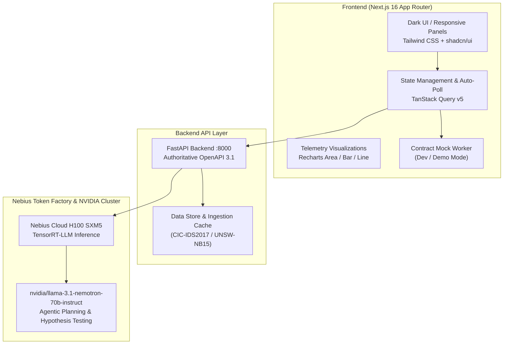

# DataSentinel 2.0: AI-Powered Autonomous SOC Dashboard

> **Nebius × NVIDIA Global AI Hackathon** — Module 3: Enterprise Dashboard, UX & Deployment

[](https://github.com/iamshrutijain11/DataSentinel)
[](https://frontend-six-tau-11.vercel.app)
[](contracts/openapi.yaml)
[](https://nebius.ai)

**Live Production URL**: [https://frontend-six-tau-11.vercel.app](https://frontend-six-tau-11.vercel.app)
**GitHub Repository**: [https://github.com/iamshrutijain11/DataSentinel](https://github.com/iamshrutijain11/DataSentinel)

DataSentinel 2.0 is an enterprise-grade AI-powered Security Operations Center (SOC) dashboard built to analyze millions of network flow records, surface high-fidelity anomaly detections, and launch autonomous investigation agents powered by **NVIDIA Nemotron-70B** on **Nebius Cloud**.

---

## 🏛 Architecture



---

## 🌟 The 7 Core Operational Interfaces

1. **Overview Dashboard (`/dashboard`)**
   - Live cluster statistics: Total events processed, critical & high detections, throughput in EPS (events/sec).
   - 7-day multi-line alert history categorized by severity.
   - Interactive severity breakdown donut chart.
   - Top threat source IPs with ASN mapping, geolocation, and alert counts.
   - Live table of recent investigations with AI confidence scores.

2. **Dataset Management (`/datasets`)**
   - Drag-and-drop file uploader supporting `.pcap`, `.csv`, `.json`, and `.log` streams.
   - Real-time client-side file validation (size threshold, extension checking).
   - Ingestion status tracker (`UPLOADING` → `VALIDATING` → `PROCESSING` → `READY` → `FAILED`).
   - Detailed schema inspector displaying normalized field mappings and header warnings.

3. **Alerts Center (`/alerts`)**
   - Paginated security threat table with server-side query state.
   - Multi-parameter filter panel: severity chips, status dropdown, detection vector filter, and full-text keyword search.
   - Risk score arc gauge (`0–100`) with color gradients.
   - Forensic detail drawer showing raw packet payloads, JA3 signatures, DNS entropy metrics, and one-click AI investigation dispatch.

4. **Investigation Workspace (`/investigations`) — *Flagship Feature***
   - **Three-Panel Investigative UI**:
     - **Left**: Alert metadata, affected endpoints, and historical investigation selector.
     - **Center**: Agent execution timeline displaying live lifecycle phases (`QUEUED` → `PLANNING` → `EVIDENCE_COLLECTION` → `HYPOTHESIS_TESTING` → `REPORT_GENERATION` → `COMPLETED`).
     - **Right**: Key findings with confidence ratings, MITRE ATT&CK technique tags (e.g., `T1071.001`, `T1055.012`), actionable SOC remediation recommendations, and JSON report export.
   - Real-time background polling until terminal completion.

5. **Network Activity (`/network`)**
   - Inbound vs. Outbound bandwidth volume area chart (Mbps/Gbps).
   - Protocol distribution breakdown (HTTPS, DNS, SMB, SSH, TCP).
   - Top communicating host pairs with flow counts and risk classifications.
   - Highlighted suspicious time window timeline with anomaly scores.
   - Geolocation destination threat map.

6. **Benchmarks (`/benchmarks`)**
   - Measured benchmark metrics on NVIDIA Nemotron-70B on Nebius H100 SXM5 infrastructure.
   - Latency P50 (18.4ms) and P95 (42.1ms).
   - Token generation rate (1,420+ tokens/sec) and peak memory consumption.
   - Grouped bar chart comparing Precision, Recall, and F1 score across CIC-IDS2017, UNSW-NB15, and KDD-CUP99.
   - Model comparison matrix comparing Nemotron-70B against Llama-3-70B and Mistral-Large.

7. **System Status (`/status`)**
   - Live health monitors with latency and uptime metrics for FastAPI Backend, Ingestion Pipeline, and Nebius Inference.
   - Active NVIDIA model details and deployment cluster configuration.
   - Timestamp and outcome of the latest completed inference job.
   - Live error and warning log stream.

---

## 🚀 Judge Demo Walkthrough (1-Minute Path)

1. Open the dashboard at `http://localhost:3000`. Observe the live 18,420 EPS throughput and alert trends.
2. Navigate to **Datasets** (`/datasets`). Inspect `CIC-IDS2017` to review the 2.8M ingested rows and normalized field mappings.
3. Switch to **Alerts** (`/alerts`). Filter by `CRITICAL` severity to see `ALT-9041` (Command & Control beaconing).
4. Click `ALT-9041` to open the Forensic Drawer. Review the JA3 hash and Let's Encrypt certificate mismatch.
5. Click **Launch AI Investigation**.
6. The app opens the **Investigation Workspace** (`/investigations`), showing Nemotron-70B executing reasoning steps:
   - Tool 1: `ThreatHypothesisGenerator` (Formulates C2 beaconing hypothesis).
   - Tool 2: `FlowGraphCorrelator` (Validates 48 TLS sessions).
   - Tool 3: `ProcessMemoryAnalyzer` (Detects process injection in `rundll32.exe`).
   - Tool 4: `MitreAttackMapper` (Maps to MITRE `T1071.001` and `T1055.012`).
7. Review the confidence score (94%) and remediation recommendations, then click **Export Investigation Report**.
8. Visit **Benchmarks** (`/benchmarks`) to see the measured F1 score (0.962) and token throughput on Nebius H100 hardware.

---

## 🛠 Quickstart Guide

### Prerequisites
- Node.js 20+
- pnpm 9+ or npm / yarn

### Local Setup
```bash
# 1. Clone repository
git clone https://github.com/iamshrutijain11/DataSentinel.git
cd DataSentinel/frontend

# 2. Install dependencies
pnpm install

# 3. Start development server (Mocks enabled by default for standalone demo)
pnpm dev
```
Open [http://localhost:3000](http://localhost:3000) in your browser.

### Switching Between Standalone Mock Mode & Live FastAPI Backend
In `frontend/.env.local`:
```bash
# For standalone presentation without backend running:
NEXT_PUBLIC_USE_MOCKS=true

# For connecting to live FastAPI backend on port 8000:
NEXT_PUBLIC_USE_MOCKS=false
NEXT_PUBLIC_API_URL=http://localhost:8000
```

---

## 🧪 Testing

```bash
cd frontend

# Run TypeScript typecheck
npx tsc --noEmit

# Run Next.js production build test
pnpm build

# Run Playwright End-to-End test suite
npx playwright test
```

---

## 📦 Docker Deployment

Run the complete multi-container stack (Frontend + Backend):
```bash
# From repository root
docker compose up --build
```
- Dashboard: `http://localhost:3000`
- API & Swagger Docs: `http://localhost:8000/docs`

---

## 📄 API Specification

The full, typed OpenAPI 3.1 specification is available in [`contracts/openapi.yaml`](contracts/openapi.yaml).
All frontend API calls use the strongly typed client in [`frontend/src/lib/api/endpoints.ts`](frontend/src/lib/api/endpoints.ts).
